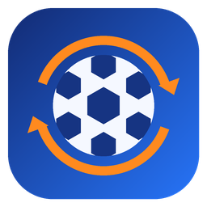

# RL Map Loader

A Windows app for playing Rocket League workshop maps: pick a map from a gallery (or from an in-game
overlay) and it's swapped into **Underpass** — then just start Free Play on Underpass.



## Features

- **Gallery** of your custom maps (`.upk` / `.udk`, sub-folders included) with search, sort and favorites.
- **Map pictures**: uses the image that came with the map — `preview.jpg` in the map's folder, or an image with
  the same name as the map. Maps without a picture show their name instead. Right-click → *Choose image…* (or
  drop an image on a card) to set your own.
- **Map details** from the common download format (`MapFolder/map.udk + preview.jpg + info.json`): the folder
  name is used as the title, plus `author` and `desc`. A `MapName.json` next to a map works too.
- **In-game overlay** (default **F3**, changeable): a small picker on top of the game. Type to search,
  ↑/↓ to pick, Enter to load, Esc to close. Needs Rocket League in *Borderless* or *Windowed* display mode.
- **Safe swapping**
  - The original `Labs_Underpass_P.upk` is kept as `Labs_Underpass_P.upk.bak` (same convention as other
    loaders, so they interoperate) plus a private safety copy in `%LOCALAPPDATA%\RLMapLoader\Backup`.
  - Originals are recognised by their package header (Psyonix packages have a non-zero licensee version,
    UDK-built maps have 0), so game updates and other loaders can't confuse it.
  - The map is copied to a temp file first and swapped in at the end; nothing changes if Rocket League has the
    file open or no backup of the original exists.
  - *Restore original* any time; optionally restored automatically when you exit.
- Drag & drop `.upk` / `.udk` / `.zip` files to add maps, tray icon, start with Windows.

## Use

1. Run `RLMapLoader.exe` (needs the [.NET 9 Desktop Runtime](https://dotnet.microsoft.com/download/dotnet/9.0)).
2. Settings (gear icon): set
   - **Rocket League maps folder** — `rocketleague\TAGame\CookedPCConsole` (auto-detected for Epic and Steam)
   - **Custom maps folder** — where you keep downloaded maps
3. Click a map → **Load map** (or press F3 in game).
4. In Rocket League: **Training → Free Play → Underpass**.
5. **Restore original** before playing online.

## Build

```powershell
dotnet build RLMapLoader\RLMapLoader.csproj -c Release
dotnet publish RLMapLoader\RLMapLoader.csproj -c Release -r win-x64 --self-contained false -p:PublishSingleFile=true -o RLMapLoader-App
```

Swap-logic tests (run against a sandbox folder, never the real game folder):

```powershell
dotnet run --project tests\SwapTest -- <workDir> <original Labs_Underpass_P.upk> <mapA.upk> <mapB.upk> <mapsFolder>
```

## tools/airdribble-patch

Python scripts used to fix the *Air Dribble Challenge* workshop map in place (every object keeps its exact size
and offset). `upk.py` reads uncompressed UDK (v868) packages, `kgraph.py` prints the Kismet graph,
`ptree.py` is a lossless tagged-property editor, and `patch_airdribble.py` applies the fix:

- starts the map's unused *ResetTraining pressed* watcher at level load, so every reset re-spawns the ball at
  the car (the map otherwise relied only on the *car spawned* event)
- re-checks the watcher every 0.1 s instead of instantly (no same-frame loop while the button is held)
- links the final-time / best-time texts to the player like the live timer
- sets `MaxTriggerCount = 0` on the *Car Spawned* and *Reset* remote events (Kismet events default to firing
  once, so the map's reset logic stopped after the first reset)
- re-spawns the ball 0.4 s after a reset (was 0.1 s) so it lands after the game's own ball reset

```powershell
python patch_airdribble.py AirDribble_Challenge.upk AirDribble_Challenge_Fixed.upk
python kgraph.py AirDribble_Challenge_Fixed.upk
```
